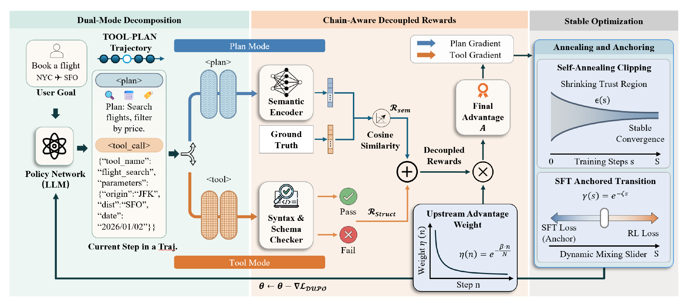

# DUPO: Dual-Mode Unified Policy Optimization for Tool-Using Agents

[English](README.md) | [安装](docs/INSTALLATION.md) | [数据](docs/DATA.md) | [训练](docs/TRAINING.md) | [评测](docs/EVALUATION.md) | [复现核对](docs/REPRODUCIBILITY.md)

DUPO 面向多步工具调用训练，将每一步动作表示为自然语言 `<plan>` 与可执行 `<tool_call>` 两个结构化区段，并在 [verl](https://github.com/volcengine/verl) 上实现步骤奖励、前序决策加权和延续式训练。

<p align="center">
  
</p>

<p align="center"><em>图 4：Dual-Mode Unified Policy Optimization（DUPO）框架示意图。</em></p>

DUPO 将轨迹中的每一步拆分为 PLAN 与 TOOL 两种优化模式，通过链式解耦奖励分别分配信用，并结合 SFT 锚定与自适应裁剪，稳定地从监督学习过渡到强化学习。

## 本仓库包含什么

- 支持环境变量配置的训练入口 `deepaction/train_dupo.sh`。
- 包含 DUPO 奖励、延续训练和动态裁剪改动的 verl 训练核心。
- PLAN-TOOL 数据准备、字段校验与最小示例。
- 无需 GPU 的仓库检查和奖励函数冒烟测试。
- BFCL v3、API-Bank、Tau2 的评测指南。

本仓库不包含完整 PlanArena 数据集和预训练模型权重。`examples/` 下的合成样例仅用于验证数据与奖励链路，支持的数据格式见 [数据说明](docs/DATA.md)。

## 五分钟跑通

### 1. 安装

参考环境为 Linux、Python 3.10、CUDA 12.1+、PyTorch 2.6、vLLM 0.8.2/0.8.3。训练需要 NVIDIA GPU，论文实验使用 A100 80 GB。

```bash
conda create -n dupo python=3.10 -y
conda activate dupo
python -m pip install -e './verl[vllm]'
python -m pip install flash-attn --no-build-isolation
```

完整环境与容器方案见 [docs/INSTALLATION.md](docs/INSTALLATION.md)。

### 2. 无 GPU 自检

```bash
python scripts/check_release.py
PYTHONPATH="$PWD/verl" python scripts/smoke_reward.py
```

### 3. 生成最小 Parquet 数据

```bash
python scripts/prepare_data.py \
  --input examples/mini_planarena.json \
  --output-dir data/mini
```

示例数据只用于验证链路，不代表 PlanArena，也不能用于有效训练或论文评测。

### 4. 检查训练命令

```bash
DATA_DIR="$PWD/data/mini" \
BASE_MODEL="Qwen/Qwen2.5-3B-Instruct" \
DRY_RUN=1 \
bash deepaction/train_dupo.sh
```

在 GPU 环境中去掉 `DRY_RUN=1` 即可启动。全部参数见 [docs/TRAINING.md](docs/TRAINING.md)。

## 目录

```text
deepaction/              DUPO 训练入口
docs/                    安装、数据、训练、评测与复现说明
examples/                可校验的最小样例
scripts/                 数据准备、仓库检查与冒烟测试
verl/                    带 DUPO 改动的 verl 0.3.1.dev
```

## 复现说明

当前实现保留文档中说明的训练行为和默认配置。论文配置、实现对应关系及已知复现边界见 [算法说明](docs/ALGORITHM.md) 与 [复现核对](docs/REPRODUCIBILITY.md)。

## 许可证

DUPO 原创材料采用 CC BY-NC 4.0，允许在署名和非商业条件下分享与改编；`verl/` 子目录继续采用 Apache-2.0。详见 [LICENSE](LICENSE)、[verl/LICENSE](verl/LICENSE) 与 [THIRD_PARTY_NOTICES.md](THIRD_PARTY_NOTICES.md)。
